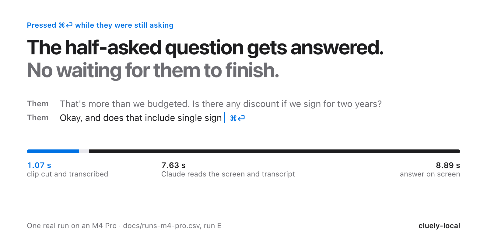

# cluely-local

Cluely, rebuilt in a day, running on your Mac. It transcribes your call locally as it happens. Press ⌘⏎, even while they're still mid-question, and Claude reads your screen and the last five minutes of the call, then tells you what to say.

<picture>
  <source media="(prefers-color-scheme: dark)" srcset="docs/hero-dark.png">
  
</picture>

Free and open source, about 1,350 lines of Swift. Transcription runs on your Mac with whisper.cpp. Answers come from Claude Haiku through the Claude Code plan you already have, at about $0.006 a question.

## Quick start

```sh
git clone https://github.com/eliotb26/cluely-local.git && cd cluely-local
./scripts/setup.sh
.build/release/cluely-local
```

Setup needs Homebrew and Xcode's command-line tools. It installs whisper.cpp and ffmpeg, fetches the `audiotee` binary, downloads the 574 MB speech model into `models/` (both are checksum-pinned) and builds. If [wispr-local](https://github.com/eliotb26/wispr-local) sits next to this folder, setup links that model instead of downloading it again. Run cluely-local from the repo folder, because that's where it looks for the model.

Join a call. Lines appear in the terminal and in `transcript.md`:

```
- [14:23:27] Them: That's more than we budgeted. Is there any discount if we sign for two years?
- [14:23:42] Them: Okay, and does that include single sign
```

Press ⌘⏎ whenever you want help. You don't type anything. The answer appears in a small always-on-top window and in the terminal, and the window hides itself after a minute. To ask something specific, run this from a second terminal:

```sh
.build/release/cluely-local ask what did they say their budget was
```

Ctrl+C stops listening. Press it twice to quit without waiting for the last clips.

### Modes

Like Cluely's meeting templates, a mode adds a paragraph of instructions to every question:

```sh
.build/release/cluely-local --mode coding      # restate the problem, approach, complexity, edge cases, then code
.build/release/cluely-local --mode interview   # one real example, situation, action, result; never invents experience
.build/release/cluely-local --mode sales       # answer the objection, use their numbers, propose a next step
```

The default is `general`: at most four short lines you can say out loud.

## What's inside Cluely

I took Cluely 2.1.20 apart before building this. Here's how it works, and what this rebuild copies.

- **No bot joins your call.** Cluely records your Mac's audio output with [AudioTee](https://github.com/makeusabrew/audiotee), a free open-source tool, in 50 ms chunks. That's why it works with Zoom, Meet, Teams, or anything else. This rebuild runs the same binary.
- **It doesn't know who's talking.** Your microphone is "Me" and everything your Mac plays is "Them". There's no voice matching. While Them is talking, the mic is muted for transcription so the call coming out of your speakers isn't written down as you.
- **It doesn't stream.** A voice activity detector (Silero, in the browser) waits for 300 ms of quiet, then sends the clip to be transcribed. Clips under 400 ms of speech are dropped, and no clip runs past 20 s. When four clips are already being transcribed, the next one is thrown away. This rebuild queues them instead (`--drop-at 4` restores Cluely's rule).
- **It doesn't detect questions.** Nothing in the app decides "that was a question". When you hit Assist with the box empty, it sends a fixed line, roughly "I'm in a conversation and asking for help without saying what I need", with the transcript and a screenshot. The model works out the question. The trick is timing: pressing the key ends the clip still being spoken and uploads that unfinished audio with the request, so a question that's half asked still makes it in. cluely-local does the same: ⌘⏎ cuts the clip and waits for whisper (about a second) before asking.
- **Every question includes a screenshot,** taken just before asking. That's how it can answer a coding problem it has only seen on screen.
- **It hides from screen sharing** with one Electron call, `setContentProtection(true)`. **This rebuild doesn't.** The answer window stays visible, so anyone you share your screen with can see it.
- **The app is a website.** The window loads its interface from `renderer.v2.cluely.com`, so Cluely can change the app without shipping an update.

## How it works

1. `audiotee` taps system audio (Core Audio taps, macOS 14.2+) and ffmpeg reads the mic, both as 16 kHz PCM.
2. Each stream has its own voice activity detector with Cluely's settings. Silero needs an ONNX runtime, so this uses a small energy detector with the same thresholds and timings: loudness above a tracked noise floor, mapped to a 0 to 1 score.
3. Each finished clip becomes a WAV, `whisper-cli` transcribes it, and a line goes into `transcript.md`. Clips are transcribed one at a time, in a queue.
4. On ⌘⏎, the clips in progress are cut and transcribed. Then `screencapture` grabs the screen, shrunk to 1,600 px, and the prompt goes to Claude Haiku laid out the way Cluely lays it out: `<screen_use>`, then `<audio_transcript>`, then the question.
5. Claude is called through the [Claude Code](https://claude.com/claude-code) CLI on your existing plan. Its only tool is Read, limited to the screenshot. If `ANTHROPIC_API_KEY` is set, it calls the API directly with the image attached.

## Measured on an M4 Pro

These are real runs from 2026-10-19 on macOS 26.3.1. Every row, labelled by run, is in [docs/runs-m4-pro.csv](docs/runs-m4-pro.csv). Each clip and each question appends its timings to `runs.csv`, never what was said.

| | Result |
|---|---|
| Them: voice stops → line appears (stopwatch, 18 clips) | 1.71 to 2.87 s, median 2.18 s |
| Them: last speech frame → line appears (app's own clock, 19 clips) | 1.26 to 2.19 s, median 1.62 s |
| …of which is waiting for 300 ms of quiet | 0.32 s |
| whisper per clip, 1.4 to 6.4 s of audio (37 clips) | 0.77 to 1.85 s, median 1.06 s |
| ⌘⏎ mid-question → half-sentence in the transcript (run E) | 1.25 s |
| Ask → answer printed (5 asks) | 5.9 to 8.9 s, median 8.9 s |
| …of which is Claude | 5.7 to 8.7 s |
| Tokens per ask | 28,000 to 58,000 in (mostly cached), 500 to 1,100 out |
| Cost per ask, as reported by the CLI | $0.0055 to $0.0067 |
| Burst of 13 clips at once, queued | 13 of 13 transcribed |
| The same burst with Cluely's 4-clip rule (`--drop-at 4`) | 4 kept, 9 dropped |

How these were measured:

- `scripts/fake_call.py` builds a scripted call with two `say` voices and plays it, captured and muted, so nothing is heard. It knows when each line ends, so it can time each transcript line against the moment the voice actually stopped. Those stopwatch times include `afplay` and audiotee's own delay, so they are an upper bound.
- For run E, ⌘⏎ was pressed 2.8 s into a 4.4 s question. The half-sentence was transcribed, and the answer was about the question being asked.
- The burst test feeds a 44 s file of 12 sentences in faster than real time (`--file`), so every clip arrives at once. One sentence split at a pause, which makes 13 clips.

## Limitations

- **The mic hears the room.** Me is whatever the mic picks up. The energy detector can't tell your voice from people talking nearby, and neither could Silero when the background is also speech. A headset fixes most of it.
- **300 ms of quiet is short.** A pause mid-sentence can split one sentence into two lines. That's what Cluely does too. Change `redemptionMs` in `VADConfig` if you'd rather wait longer.
- **The default mic might not be the one you're using.** If AirPods are the default input, they're what gets heard. Use `--mic-device "MacBook Pro Microphone"` to pick another.
- **Whisper invents words on near-silence.** Short clips sometimes come back as "Thank you." Lines with no words are dropped, but those aren't.
- **Asking takes 6 to 9 s,** mostly because the CLI starts fresh each time. The direct API path (`ANTHROPIC_API_KEY`) skips that, but it wasn't measured here.
- **Everyone on the call is "Them".** Speakers are told apart by source, not by voice.
- **Only tested on one machine,** an M4 Pro, with synthetic `say` voices. Requires macOS 14.2 or later.

## Privacy and consent

Transcription is local: audio never leaves your Mac. Clips are written to temporary WAVs, transcribed and deleted. The transcript stays in `transcript.md`, readable only by you. Delete it whenever you like.

When you ask, **your whole screen** and the last five minutes of transcript are sent to Anthropic. Nothing is sent until you ask. With the CLI, the session isn't saved to Claude Code's history.

It records other people. Tell them, and check the law where you are: some places require everyone on a call to agree to being recorded.

## Make your own

The app is small enough to reshape with Claude Code. Open it in this folder and ask for what you want: Silero instead of the energy detector, a menu bar icon, answers that stream in, or a local model. Or start from scratch:

> Build a macOS command-line tool in Swift that transcribes my calls locally. Record system audio with audiotee as "Them" and the mic as "Me", split them into clips on pauses, and transcribe each with whisper.cpp. When I press Command-Return, take a screenshot and send it with the last five minutes of transcript to Claude, and show the answer in a small floating window.

## Permissions

The first time it runs, macOS asks your terminal app for:

- **Microphone**, to hear you.
- **System Audio Recording**, to hear the call. It's under System Settings > Privacy & Security > Screen & System Audio Recording.
- **Screen Recording**, for the screenshot sent with each question.

Restart the terminal after granting them. The hotkey doesn't need Accessibility permission.

## Development

```sh
swift build -c release
swift test
```

`Sources/CluelyLocalCore` holds everything that can be tested without audio: voice activity detection, the echo gate, Me/Them labelling, the clip queue, transcript parsing, prompt assembly and options. It has 37 tests. `Sources/cluely-local` is the app: audio processes, whisper and Claude calls, the hotkey and the window.

The tests use Swift Testing, which needs full Xcode. If `swift test` can't find it, prefix it with `DEVELOPER_DIR=/Applications/Xcode.app/Contents/Developer`. To redraw the hero image, run `docs/src/render.sh`.

## Credits

System audio capture is [AudioTee](https://github.com/makeusabrew/audiotee) by makeusabrew (MIT), the same binary Cluely ships. Transcription is [whisper.cpp](https://github.com/ggml-org/whisper.cpp) running `ggml-large-v3-turbo-q5_0.bin`. Answers come from Claude Haiku. The settings, prompt layout and ⌘⏎ behaviour come from studying Cluely 2.1.20. No Cluely code is used.

## License

MIT. See [LICENSE](LICENSE).

cluely-local is an independent project. It is not affiliated with or endorsed by Cluely, and Cluely is a trademark of its owner.
